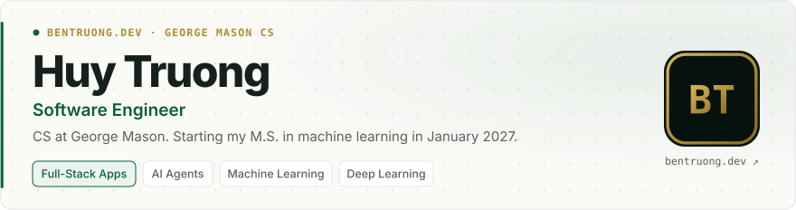
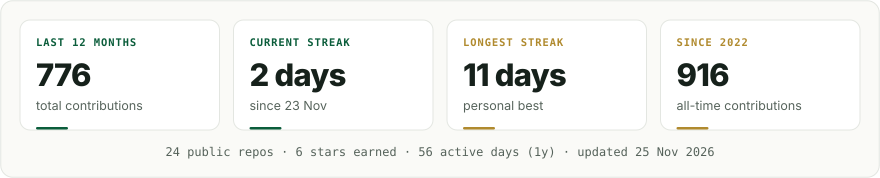
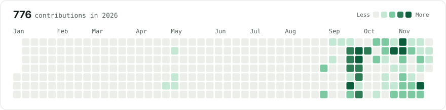
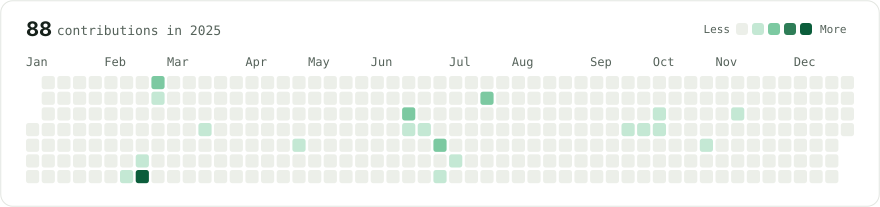
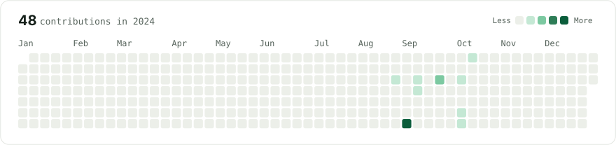
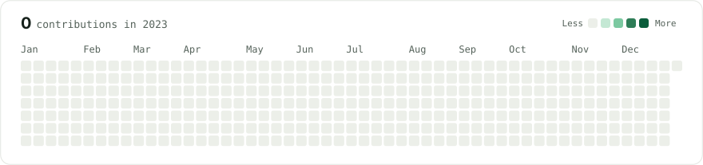
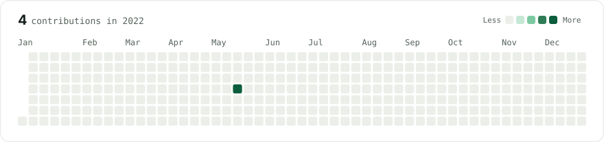
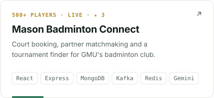
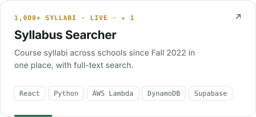
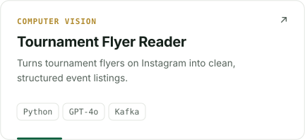

<a href="https://bentruong.dev"><picture><source media="(prefers-color-scheme: dark) and (max-width: 600px)" srcset="assets/bt-hero-phone-dark.svg"><source media="(max-width: 600px)" srcset="assets/bt-hero-phone-light.svg"><source media="(prefers-color-scheme: dark)" srcset="assets/bt-hero-dark.svg"></picture></a>

<a href="https://bentruong.dev"><picture><source media="(prefers-color-scheme: dark)" srcset="assets/bt-badge-site-dark.svg"></picture></a>
<a href="https://bentruong.dev/Huy_Truong_Resume.pdf"><picture><source media="(prefers-color-scheme: dark)" srcset="assets/bt-badge-resume-dark.svg"></picture></a>
<a href="https://linkedin.com/in/huy-nm-truong"><picture><source media="(prefers-color-scheme: dark)" srcset="assets/bt-badge-li-dark.svg"></picture></a>
<a href="mailto:bentruong.swe@gmail.com"><picture><source media="(prefers-color-scheme: dark)" srcset="assets/bt-badge-mail-dark.svg"></picture></a>

<picture><source media="(prefers-color-scheme: dark) and (max-width: 600px)" srcset="assets/bt-label-activity-phone-dark.svg"><source media="(max-width: 600px)" srcset="assets/bt-label-activity-phone-light.svg"><source media="(prefers-color-scheme: dark)" srcset="assets/bt-label-activity-dark.svg"></picture>

<picture><source media="(prefers-color-scheme: dark) and (max-width: 600px)" srcset="assets/bt-github-phone-dark.svg"><source media="(max-width: 600px)" srcset="assets/bt-github-phone-light.svg"><source media="(prefers-color-scheme: dark)" srcset="assets/bt-github-dark.svg"></picture>

<picture><source media="(prefers-color-scheme: dark) and (max-width: 600px)" srcset="assets/bt-graph-6m-phone-dark.svg"><source media="(max-width: 600px)" srcset="assets/bt-graph-6m-phone-light.svg"><source media="(prefers-color-scheme: dark)" srcset="assets/bt-graph-6m-dark.svg"></picture>

Last 12 months: 776 contributions

<picture><source media="(prefers-color-scheme: dark) and (max-width: 600px)" srcset="assets/bt-graph-12m-phone-dark.svg"><source media="(max-width: 600px)" srcset="assets/bt-graph-12m-phone-light.svg"><source media="(prefers-color-scheme: dark)" srcset="assets/bt-graph-12m-dark.svg"></picture>

2026: 776 contributions

<picture><source media="(prefers-color-scheme: dark) and (max-width: 600px)" srcset="assets/bt-graph-2026-phone-dark.svg"><source media="(max-width: 600px)" srcset="assets/bt-graph-2026-phone-light.svg"><source media="(prefers-color-scheme: dark)" srcset="assets/bt-graph-2026-dark.svg"></picture>

2025: 88 contributions

<picture><source media="(prefers-color-scheme: dark) and (max-width: 600px)" srcset="assets/bt-graph-2025-phone-dark.svg"><source media="(max-width: 600px)" srcset="assets/bt-graph-2025-phone-light.svg"><source media="(prefers-color-scheme: dark)" srcset="assets/bt-graph-2025-dark.svg"></picture>

2024: 48 contributions

<picture><source media="(prefers-color-scheme: dark) and (max-width: 600px)" srcset="assets/bt-graph-2024-phone-dark.svg"><source media="(max-width: 600px)" srcset="assets/bt-graph-2024-phone-light.svg"><source media="(prefers-color-scheme: dark)" srcset="assets/bt-graph-2024-dark.svg"></picture>

2023: 0 contributions

<picture><source media="(prefers-color-scheme: dark) and (max-width: 600px)" srcset="assets/bt-graph-2023-phone-dark.svg"><source media="(max-width: 600px)" srcset="assets/bt-graph-2023-phone-light.svg"><source media="(prefers-color-scheme: dark)" srcset="assets/bt-graph-2023-dark.svg"></picture>

2022: 4 contributions

<picture><source media="(prefers-color-scheme: dark) and (max-width: 600px)" srcset="assets/bt-graph-2022-phone-dark.svg"><source media="(max-width: 600px)" srcset="assets/bt-graph-2022-phone-light.svg"><source media="(prefers-color-scheme: dark)" srcset="assets/bt-graph-2022-dark.svg"></picture>

<picture><source media="(prefers-color-scheme: dark) and (max-width: 600px)" srcset="assets/bt-label-work-phone-dark.svg"><source media="(max-width: 600px)" srcset="assets/bt-label-work-phone-light.svg"><source media="(prefers-color-scheme: dark)" srcset="assets/bt-label-work-dark.svg"></picture>

<a href="https://github.com/SuperHuyGaming/GMU-Badminton-App"><picture><source media="(prefers-color-scheme: dark) and (max-width: 600px)" srcset="assets/bt-project-badminton-phone-dark.svg"><source media="(max-width: 600px)" srcset="assets/bt-project-badminton-phone-light.svg"><source media="(prefers-color-scheme: dark)" srcset="assets/bt-project-badminton-dark.svg"></picture></a>
<a href="https://github.com/SuperHuyGaming/Syllabus-Searcher"><picture><source media="(prefers-color-scheme: dark) and (max-width: 600px)" srcset="assets/bt-project-syllabus-phone-dark.svg"><source media="(max-width: 600px)" srcset="assets/bt-project-syllabus-phone-light.svg"><source media="(prefers-color-scheme: dark)" srcset="assets/bt-project-syllabus-dark.svg"></picture></a>
<a href="https://github.com/SuperHuyGaming/badminton-tournament-finder"><picture><source media="(prefers-color-scheme: dark) and (max-width: 600px)" srcset="assets/bt-project-flyer-phone-dark.svg"><source media="(max-width: 600px)" srcset="assets/bt-project-flyer-phone-light.svg"><source media="(prefers-color-scheme: dark)" srcset="assets/bt-project-flyer-dark.svg"></picture></a>
<a href="https://github.com/SuperHuyGaming/hollow-signal"><picture><source media="(prefers-color-scheme: dark) and (max-width: 600px)" srcset="assets/bt-project-hollow-phone-dark.svg"><source media="(max-width: 600px)" srcset="assets/bt-project-hollow-phone-light.svg"><source media="(prefers-color-scheme: dark)" srcset="assets/bt-project-hollow-dark.svg"></picture></a>

Live apps: <a href="https://gmubadmintonschedule.bentruong.dev/">Mason Badminton Connect (Live)</a> · <a href="https://findmysyllabus.bentruong.dev/">Syllabus Searcher (Live)</a> More work: <a href="https://bentruong.dev/#work">C Error Tutor (PyTorch · LoRA)</a> · <a href="https://bentruong.dev/#work">Handwritten Digit Classifier (98% PyTorch)</a> · <a href="https://github.com/SuperHuyGaming/HuyResume">Portfolio Source</a>

Styled after <a href="https://bentruong.dev">bentruong.dev</a> · redrawn every night by GitHub Actions

