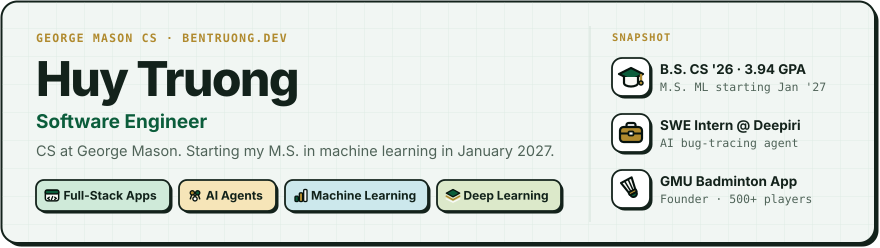
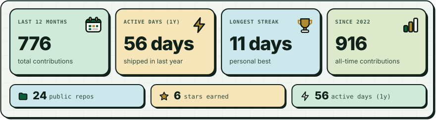
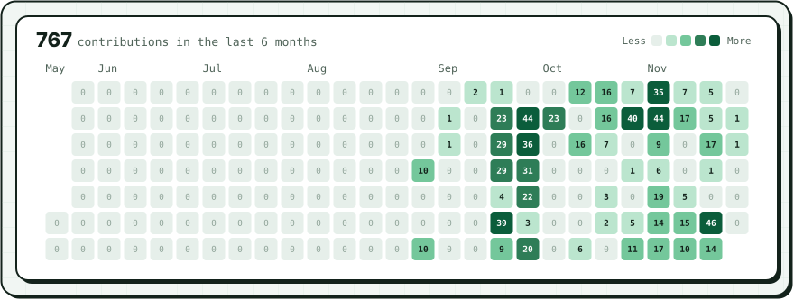
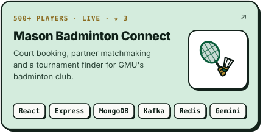
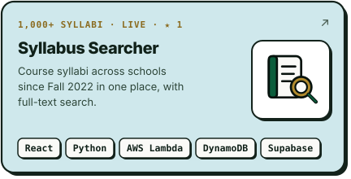
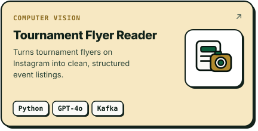
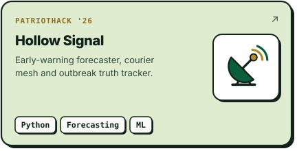

<a href="https://bentruong.dev"><picture><source media="(prefers-color-scheme: dark) and (max-width: 600px)" srcset="assets/v11-hero-phone-dark.svg"><source media="(max-width: 600px)" srcset="assets/v11-hero-phone-light.svg"><source media="(prefers-color-scheme: dark)" srcset="assets/v11-hero-dark.svg"></picture></a>

<a href="https://bentruong.dev"><picture><source media="(prefers-color-scheme: dark)" srcset="assets/v11-badge-site-dark.svg"></picture></a>
<a href="https://bentruong.dev/Huy_Truong_Resume.pdf"><picture><source media="(prefers-color-scheme: dark)" srcset="assets/v11-badge-resume-dark.svg"></picture></a>
<a href="https://linkedin.com/in/huy-nm-truong"><picture><source media="(prefers-color-scheme: dark)" srcset="assets/v11-badge-li-dark.svg"></picture></a>
<a href="mailto:bentruong.swe@gmail.com"><picture><source media="(prefers-color-scheme: dark)" srcset="assets/v11-badge-mail-dark.svg"></picture></a>

<picture><source media="(prefers-color-scheme: dark) and (max-width: 600px)" srcset="assets/v11-label-activity-phone-dark.svg"><source media="(max-width: 600px)" srcset="assets/v11-label-activity-phone-light.svg"><source media="(prefers-color-scheme: dark)" srcset="assets/v11-label-activity-dark.svg"></picture>

<picture><source media="(prefers-color-scheme: dark) and (max-width: 600px)" srcset="assets/v11-github-phone-dark.svg"><source media="(max-width: 600px)" srcset="assets/v11-github-phone-light.svg"><source media="(prefers-color-scheme: dark)" srcset="assets/v11-github-dark.svg"></picture>

<picture><source media="(prefers-color-scheme: dark) and (max-width: 600px)" srcset="assets/v11-graph-6m-phone-dark.svg"><source media="(max-width: 600px)" srcset="assets/v11-graph-6m-phone-light.svg"><source media="(prefers-color-scheme: dark)" srcset="assets/v11-graph-6m-dark.svg"></picture>

<picture><source media="(prefers-color-scheme: dark) and (max-width: 600px)" srcset="assets/v11-label-work-phone-dark.svg"><source media="(max-width: 600px)" srcset="assets/v11-label-work-phone-light.svg"><source media="(prefers-color-scheme: dark)" srcset="assets/v11-label-work-dark.svg"></picture>

<a href="https://github.com/SuperHuyGaming/GMU-Badminton-App"><picture><source media="(prefers-color-scheme: dark) and (max-width: 600px)" srcset="assets/v11-project-badminton-phone-dark.svg"><source media="(max-width: 600px)" srcset="assets/v11-project-badminton-phone-light.svg"><source media="(prefers-color-scheme: dark)" srcset="assets/v11-project-badminton-dark.svg"></picture></a>
<a href="https://github.com/SuperHuyGaming/Syllabus-Searcher"><picture><source media="(prefers-color-scheme: dark) and (max-width: 600px)" srcset="assets/v11-project-syllabus-phone-dark.svg"><source media="(max-width: 600px)" srcset="assets/v11-project-syllabus-phone-light.svg"><source media="(prefers-color-scheme: dark)" srcset="assets/v11-project-syllabus-dark.svg"></picture></a>
<a href="https://github.com/SuperHuyGaming/badminton-tournament-finder"><picture><source media="(prefers-color-scheme: dark) and (max-width: 600px)" srcset="assets/v11-project-flyer-phone-dark.svg"><source media="(max-width: 600px)" srcset="assets/v11-project-flyer-phone-light.svg"><source media="(prefers-color-scheme: dark)" srcset="assets/v11-project-flyer-dark.svg"></picture></a>
<a href="https://github.com/SuperHuyGaming/hollow-signal"><picture><source media="(prefers-color-scheme: dark) and (max-width: 600px)" srcset="assets/v11-project-hollow-phone-dark.svg"><source media="(max-width: 600px)" srcset="assets/v11-project-hollow-phone-light.svg"><source media="(prefers-color-scheme: dark)" srcset="assets/v11-project-hollow-dark.svg"></picture></a>

Live apps: <a href="https://gmubadmintonschedule.bentruong.dev/">Mason Badminton Connect (Live)</a> · <a href="https://findmysyllabus.bentruong.dev/">Syllabus Searcher (Live)</a> More work: <a href="https://bentruong.dev/#work">C Error Tutor (PyTorch · LoRA)</a> · <a href="https://bentruong.dev/#work">Handwritten Digit Classifier (98% PyTorch)</a> · <a href="https://github.com/SuperHuyGaming/HuyResume">Portfolio Source</a>

